# 海大二手書交易平台 軟體設計文件（SDD）

- 專案名稱：海大二手書交易平台
- 撰寫日期：2026/11/17
- 發展者：黃宇廷（01157009）、吳紀潓（01257129）、李宥勳（01357006）、楊孟芸（01357136）、廖子宏（01357138）

---

## 版次變更記錄

| 版次 | 變更項目 | 變更日期 |
| --- | -------- | -------- |
| 0.1 | 初版：系統模型與架構、介面需求與設計、實作方案、設計議題 | 2026/11/17 |
| 0.2 | 補上流程設計（訂單、書籍狀態圖與送出訂單活動圖）、使用者畫面設計、資料設計、類別圖 | 2026/11/17 |
| 0.3 |  |  |
| 0.4 |  |  |
| 0.5 |  |  |
| 0.6 |  |  |
| 1.0 |  |  |

---

## 目錄

1. 系統模型與架構 (System Model / System Architecture)
2. 介面需求與設計 (Interface Requirement and Design)
3. 流程設計 (Process Design)
4. 使用者畫面設計 (User Interface Design)
5. 資料設計 (Data Design)
6. 類別圖設計 (Class Diagram)
7. 實作方案 (Implementation Languages and Platforms)
8. 設計議題 (Design Issue)

---

## 1. 系統模型與架構 (System Model / System Architecture)

本系統依照 C4 Model 描述架構，延續 Lab 2 的容器圖，並補上 API 應用內部的模組（元件圖）。圖用 diagrams.net 繪製。

### 1.1 容器圖（C4 Level 2）

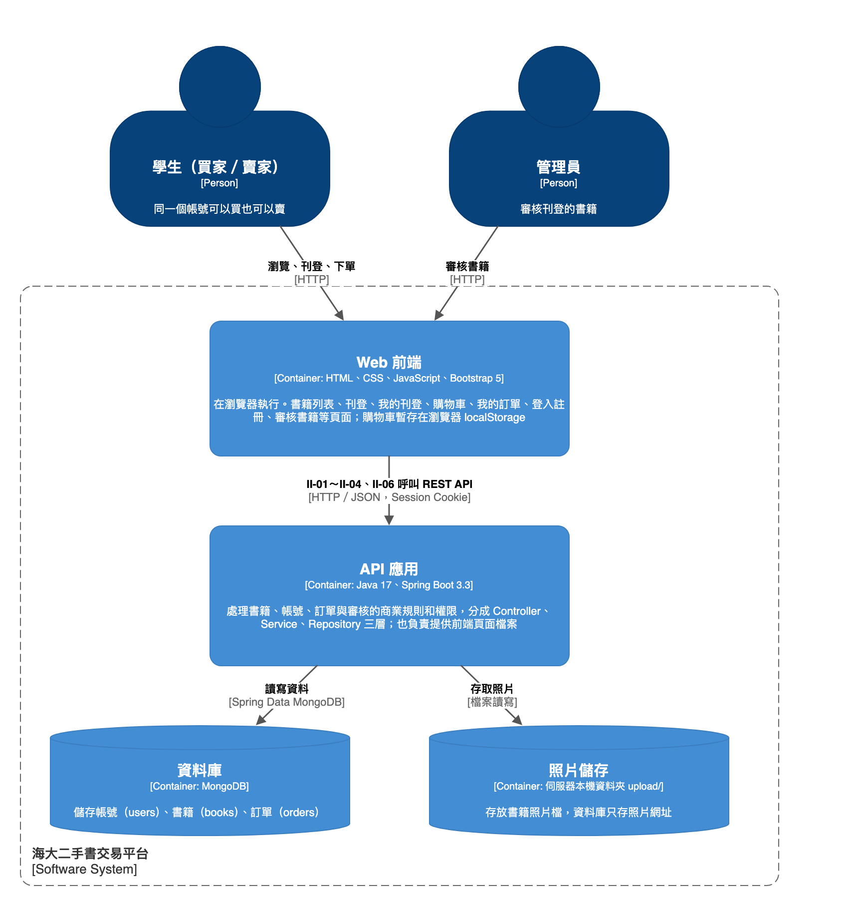

圖 1　容器圖

- **Web 前端**：在使用者的瀏覽器執行，負責顯示畫面與收集輸入，所有資料都向 API 應用取得。購物車暫存在瀏覽器的 localStorage，送出訂單時才傳給後端。
- **API 應用**：系統核心。刊登檢查、書況分級、訂單狀態轉換、運費計算、登入與權限都在這裡處理，前端只做提示。即使有人繞過網頁直接呼叫 API，也無法存入不合規的資料。
- **資料庫（MongoDB）**：儲存帳號、書籍、訂單。書籍欄位會隨需求增加，文件型資料庫不需先改資料表結構。
- **照片儲存**：照片存成檔案，資料庫只存照片網址；API 應用用 `/uploads/...` 網址提供給前端顯示。
- 系統不串接外部系統（沒有金流、Email、雲端儲存），所以目前沒有 EI-xx 對外介面。
- 交易訊息（US06）與停用帳號（US08）不在 Iteration 2 範圍，圖上沒有畫出，之後的 Iteration 再加入。

### 1.2 元件圖（API 應用內部）

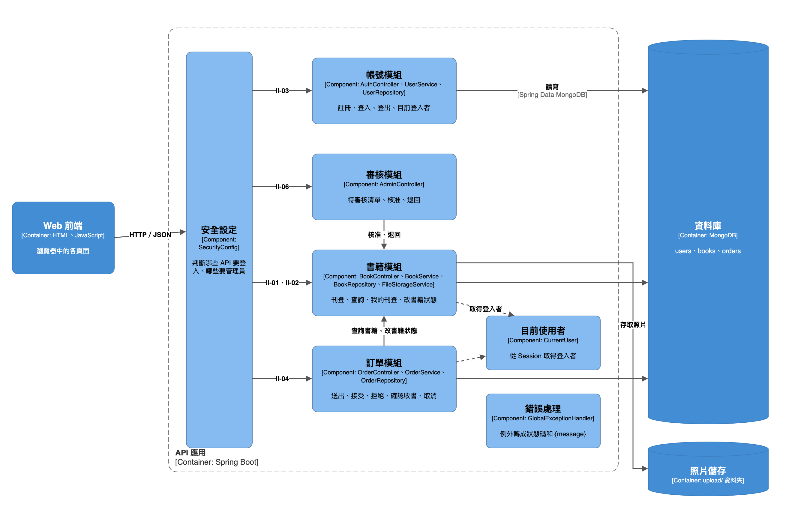

圖 2　API 應用的元件圖

- 每個請求先經過 **安全設定**：查詢書籍、註冊、登入和靜態頁面不用登入；其他 API 要登入，`/api/admin/**` 還要是管理員。
- **目前使用者**集中在 `CurrentUser` 一個地方取得，書籍與訂單模組都透過它知道「誰是賣家、誰是買家」，用使用者編號判斷權限。
- **訂單模組**會呼叫書籍模組，因為訂單狀態改變時書的狀態要一起變（例如賣家接受訂單後，書變成「保留中」）。
- 各模組的錯誤都丟出自訂例外，由 **錯誤處理** 統一轉成 HTTP 狀態碼與 `{"message": "..."}`。

---

## 2. 介面需求與設計 (Interface Requirement and Design)

介面編號沿用 Lab 2 的 II-01～II-06。介面提供者都是後端 API 應用的模組，介面使用者是前端頁面，連結方式是 HTTP。下表依照 2026/11/17 的程式整理。

**共通規則**

- 請求與回應的資料格式是 JSON，例外有兩個：刊登書籍用 `multipart/form-data`（要上傳照片），登入用表單格式（`application/x-www-form-urlencoded`）。
- 登入後，瀏覽器用 Session Cookie 帶著登入狀態，前端不用另外帶 token。
- 錯誤一律回傳 `{"message": "錯誤說明"}`。狀態碼：400 資料或狀態不對、401 沒有登入、403 沒有權限、404 找不到。

### 2.1 介面一覽

| 介面名稱 | 介面提供者 | 介面使用者 | 連結方式 | 輸入資料 | 輸出資料 | 介面描述 |
| -------- | ---------- | ---------- | -------- | -------- | -------- | -------- |
| II-01 刊登書籍 | 書籍模組（BookController、BookService） | 刊登頁 `sell.html` | POST `/api/books`（multipart/form-data），要登入 | title、author、subject、conditionGrade、condition、price、shippable、shippingFee、image | 201，新書籍的 JSON，status 為「待審核」 | 賣家刊登一本書。賣家姓名與聯絡方式從帳號帶入。書名、科目、書況等級、售價、照片必填；售價為正整數；可寄送時運費為 0 以上的整數。 |
| II-02 查詢書籍 | 書籍模組 | 書籍列表頁 `index.html` | GET `/api/books` | keyword、subject、conditionGrade、sort（都可省略） | 書籍陣列 | 只回傳「上架中」的書。sort 可為 price（預設，價格由低到高）、newest、condition。不用登入。查無結果回傳空陣列。 |
| II-02 書籍資料 | 書籍模組 | 購物車頁等 | GET `/api/books/{id}` | 書籍編號 | 一本書的 JSON | 待審核、已退回的書只有賣家本人和管理員看得到，其他人回 404。 |
| II-02 我的刊登 | 書籍模組 | 我的刊登頁 `my-books.html` | GET `/api/books/mine`，要登入 | 無 | 書籍陣列（最新的在前） | 回傳登入者自己刊登的所有書，包含每本的狀態與退回原因。 |
| II-03 註冊 | 帳號模組（AuthController、UserService） | 註冊頁 `register.html` | POST `/api/auth/register` | `{"name","email","password","contact"}` | 201，`{"id","name","email","contact","admin"}` | 只收 `@mail.ntou.edu.tw` 的 Email，Email 不能重複；密碼至少 8 個字元，用 BCrypt 雜湊後儲存。註冊後不會自動登入。 |
| II-03 登入 | 帳號模組（Spring Security） | 登入頁 `login.html` | POST `/api/auth/login`（表單格式） | email、password | 200，登入者 JSON；失敗 401 | 成功後伺服器建立 Session。失敗訊息統一為「Email 或密碼錯誤」，不透露是哪一項錯。 |
| II-03 登出 | 帳號模組 | 各頁導覽列 | POST `/api/auth/logout` | 無 | 200 | 清除 Session。 |
| II-03 目前登入者 | 帳號模組 | 各頁導覽列（`common.js`） | GET `/api/auth/me` | 無 | 登入者 JSON；沒登入 401 | 前端用它顯示登入者名稱，並判斷是不是管理員。回傳內容不含密碼。 |
| II-03 展示用管理員帳號 | 帳號模組 | 登入頁 | GET `/api/auth/demo-admin` | 無 | `{"email","password"}`；設定關閉時 404 | 課程展示用，把管理員帳號顯示在登入頁。正式上線前要關掉。 |
| II-04 送出訂單 | 訂單模組（OrderController、OrderService） | 購物車頁 `cart.html` | POST `/api/orders`，要登入 | `{"bookIds":[...],"deliveryMethod":"面交"或"寄送"}` | 201，訂單 JSON，status 為「待賣家回覆」 | 一筆訂單只能有同一位賣家的書，書都要是「上架中」，不能買自己的書。選寄送時每本都要可寄送，運費只收一次，取最高的那本。總金額 = 書價合計 + 運費。 |
| II-04 查詢訂單 | 訂單模組 | 我的訂單頁 `orders.html` | GET `/api/orders?role=buyer` 或 `role=seller`，要登入 | role | 訂單陣列 | buyer 回傳我買的訂單，seller 回傳別人向我買的訂單。 |
| II-04 訂單資料 | 訂單模組 | 我的訂單頁 | GET `/api/orders/{id}`，要登入 | 訂單編號 | 一筆訂單的 JSON | 只有該訂單的買家或賣家能看，其他人 403。 |
| II-04 接受訂單 | 訂單模組 | 我的訂單頁（賣家） | POST `/api/orders/{id}/accept` | 訂單編號 | 更新後的訂單 | 只有賣家能做，訂單要是「待賣家回覆」。訂單變「待交付」，書變「保留中」；同一本書其他「待賣家回覆」的訂單自動變「已拒絕」，並寫上拒絕原因。 |
| II-04 拒絕訂單 | 訂單模組 | 我的訂單頁（賣家） | POST `/api/orders/{id}/reject` | 訂單編號 | 更新後的訂單 | 只有賣家能做，訂單要是「待賣家回覆」。訂單變「已拒絕」，書的狀態不變。 |
| II-04 確認收書 | 訂單模組 | 我的訂單頁（買家） | POST `/api/orders/{id}/confirm` | 訂單編號 | 更新後的訂單 | 只有買家能做，訂單要是「待交付」。訂單變「已完成」，書變「已售出」。 |
| II-04 取消訂單 | 訂單模組 | 我的訂單頁 | POST `/api/orders/{id}/cancel` | 訂單編號 | 更新後的訂單 | 交付前買家或賣家都能取消。訂單變「已取消」；如果賣家已接受，書回到「上架中」。 |
| II-05 交易訊息 | 訂單模組（預計） | 我的訂單頁（預計） | `/api/orders/{id}/messages`（預計） | 訊息內容（預計） | 訊息陣列（預計） | 預計，尚未實作。對應 US06，不在 Iteration 2 範圍。 |
| II-06 待審核清單 | 審核模組（AdminController、BookService） | 審核書籍頁 `admin.html` | GET `/api/admin/books`，限管理員 | 無 | 書籍陣列（先刊登的在前） | 回傳所有「待審核」的書。沒登入 401，不是管理員 403。 |
| II-06 核准書籍 | 審核模組 | 審核書籍頁 | POST `/api/admin/books/{id}/approve`，限管理員 | 書籍編號 | 更新後的書籍 | 只有「待審核」的書能核准，書變「上架中」，買家才看得到。 |
| II-06 退回書籍 | 審核模組 | 審核書籍頁 | POST `/api/admin/books/{id}/reject`，限管理員 | `{"reason":"退回原因"}` | 更新後的書籍 | 只有「待審核」的書能退回，原因必填。書變「已退回」，賣家在「我的刊登」看得到原因。 |
| II-06 停用帳號 | 審核模組（預計） | 管理後台（預計） | `/api/admin/users/*`（預計） | 帳號編號（預計） | 帳號資料（預計） | 預計，尚未實作。對應 US08，不在 Iteration 2 範圍。 |

### 2.2 介面描述範例：II-04 送出訂單

| 項目 | 內容 |
| ---- | ---- |
| 介面名稱 | II-04 送出訂單 |
| 介面提供者 | API 應用的訂單模組（OrderController、OrderService） |
| 介面使用者 | Web 前端的購物車頁 `cart.html` |
| 連結方式 | HTTP POST `/api/orders`，Content-Type 為 `application/json`，要登入 |
| 輸入資料 | `{"bookIds": ["6720a1c3e5b2", "6720a1c3e5b3"], "deliveryMethod": "寄送"}` |
| 輸出資料 | 見下方 JSON |
| 介面描述 | 買家把購物車中同一位賣家的書送出成一筆訂單。 |

輸出資料（HTTP 201）：

```json
{
  "id": "6731b2d4f6c3",
  "buyerId": "672f00aa1111",
  "buyerName": "陳小華",
  "sellerId": "672f00bb2222",
  "sellerName": "王小明",
  "items": [
    { "bookId": "6720a1c3e5b2", "title": "資料結構", "price": 250, "shippingFee": 60 },
    { "bookId": "6720a1c3e5b3", "title": "演算法", "price": 300, "shippingFee": 80 }
  ],
  "deliveryMethod": "寄送",
  "shippingFee": 80,
  "totalAmount": 630,
  "status": "待賣家回覆",
  "rejectReason": null,
  "createdAt": "2026-11-17T14:30:00"
}
```

檢查規則與錯誤：

- 沒登入：401「請先登入」。
- `bookIds` 是空的、交付方式不是「面交」或「寄送」：400。
- 有書不是「上架中」：400，訊息寫出是哪一本書，例如「《資料結構》還沒通過審核，不能下單」。
- 書不是同一位賣家、買自己刊登的書：400。
- 選寄送但有書不可寄送：400，訊息寫出是哪一本書。
- 失敗時不建立訂單，也不改任何書的狀態，前端的購物車保持原樣。

---

## 3. 流程設計 (Process Design)

本章用 UML 狀態圖說明訂單和書籍的狀態怎麼改變，再用活動圖說明買家送出訂單的流程。圖用 diagrams.net 繪製，都依照目前的程式（`OrderService`、`BookService`）。

### 3.1 訂單狀態圖

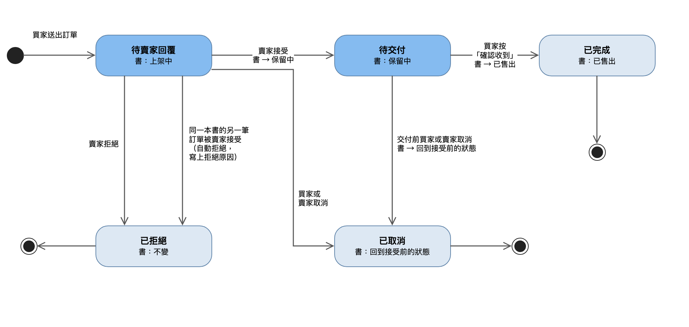

圖 3　訂單狀態圖

- 買家送出訂單後，訂單是「待賣家回覆」。這時書的狀態不變，其他買家還可以下單買同一本書。
- 賣家接受後，訂單變「待交付」，書變「保留中」，其他買家不能再下單。
- 同一本書可能有好幾筆「待賣家回覆」的訂單。賣家接受其中一筆時，系統把其他筆自動改成「已拒絕」，並寫上拒絕原因（例如「賣家已接受其他買家的訂單：《資料結構》」）。買家在「我的訂單」就看得出是自動拒絕，不是賣家手動拒絕。一筆訂單裡只要有一本書被保留，整筆都拒絕，不拆開。
- 買家收到書後按「確認收到」，訂單變「已完成」，書變「已售出」。只有買家能按。
- 交付前（「待賣家回覆」或「待交付」）買家或賣家都能取消。「待交付」的訂單取消時，書回到賣家接受前的狀態（目前一定是「上架中」）。
- 「已完成」、「已拒絕」、「已取消」都是終止狀態，不能再改變。
- 每個操作都會先檢查目前狀態和操作者。不符合時回傳 400 或 403，訂單和書的狀態都不變。

### 3.2 書籍狀態圖

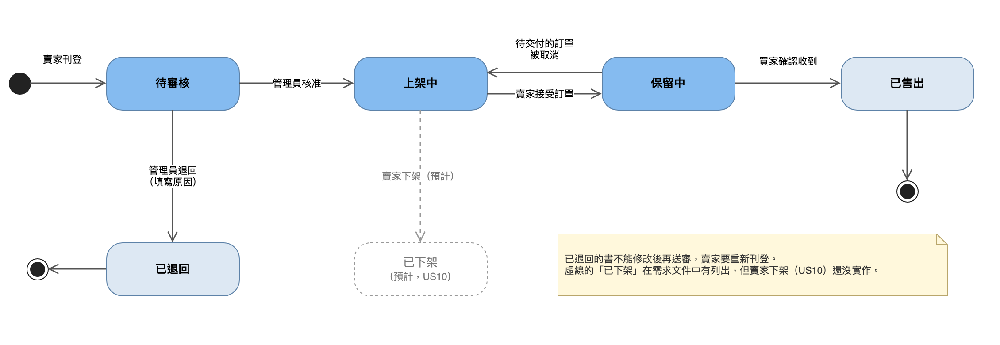

圖 4　書籍狀態圖

- 賣家刊登後，書是「待審核」，只有賣家本人和管理員看得到。
- 管理員核准後變「上架中」，買家才能在列表找到並下單。管理員退回時要填原因，書變「已退回」，賣家在「我的刊登」看得到原因。
- 「上架中」、「保留中」、「已售出」之間的改變都由訂單帶動，見 3.1。
- 已退回的書不能修改後再送審，賣家要重新刊登。
- 虛線的「已下架」是需求文件列出的狀態，對應 US10（賣家下架），目前還沒實作，所以畫成虛線。

### 3.3 送出訂單活動圖

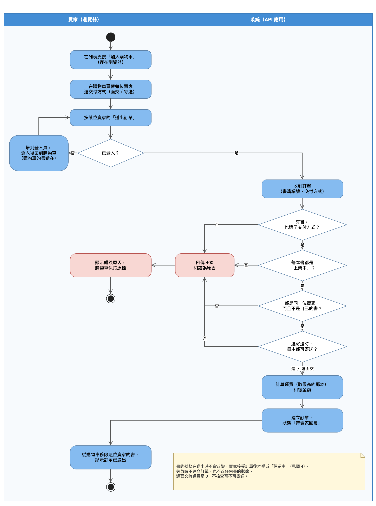

圖 5　送出訂單活動圖

- 購物車存在瀏覽器，沒登入也能加入購物車、選交付方式。按「送出訂單」時才檢查登入；沒登入就帶到登入頁，登入後回到購物車，書都還在。
- 購物車依賣家分組，每組各自選交付方式、各自送出。一次送出只會建立一筆訂單，只包含同一位賣家的書。
- 系統依圖中的順序檢查。任一項不通過就回傳 400 和原因（例如「《資料結構》已被保留或售出，不能下單」），不建立訂單。瀏覽器顯示原因，購物車保持原樣。如果購物車裡的書已經被刪掉（書籍編號查不到），回傳 404「找不到這本書」，圖中沒有另外畫出。
- 運費：面交是 0；寄送時一筆訂單只收一次，取這幾本書中最高的運費。總金額是書價合計加運費。
- 送出成功後，瀏覽器只從購物車移除這位賣家的書，其他賣家的書還在。

---

## 4. 使用者畫面設計 (User Interface Design)

本章是目前程式的實際畫面，用電腦瀏覽器（寬 1280 像素）截圖。畫面用 Bootstrap 5 排版。書籍封面是測試用的圖片，帳號、書和訂單都是測試資料。

所有頁面上方都有同一條導覽列：書籍列表、刊登書籍、購物車（紅色數字是購物車裡的書數）、我的訂單、我的刊登，右邊是登入者姓名和登出。管理員多一個「審核書籍」。沒登入時右邊顯示「登入」和「註冊」。

### 4.1 登入、註冊（US01）

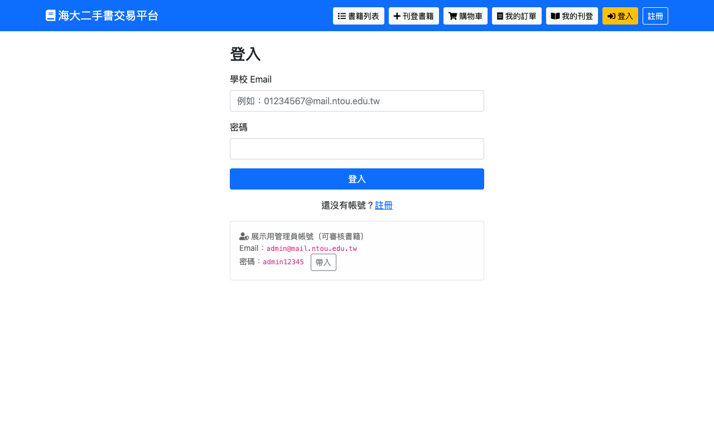

畫面 1　登入頁

- 用學校 Email 和密碼登入。失敗時統一顯示「Email 或密碼錯誤」。
- 下方顯示展示用的管理員帳號，方便課堂展示審核功能，按「帶入」會填好帳號密碼。正式上線前要關掉。

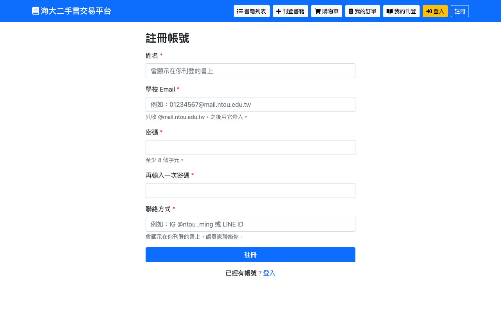

畫面 2　註冊頁

- 填姓名、學校 Email、密碼（兩次）、聯絡方式。只收 `@mail.ntou.edu.tw` 的 Email。
- 註冊成功後帶到登入頁，不會自動登入。

### 4.2 書籍列表（US02、US03、US04）

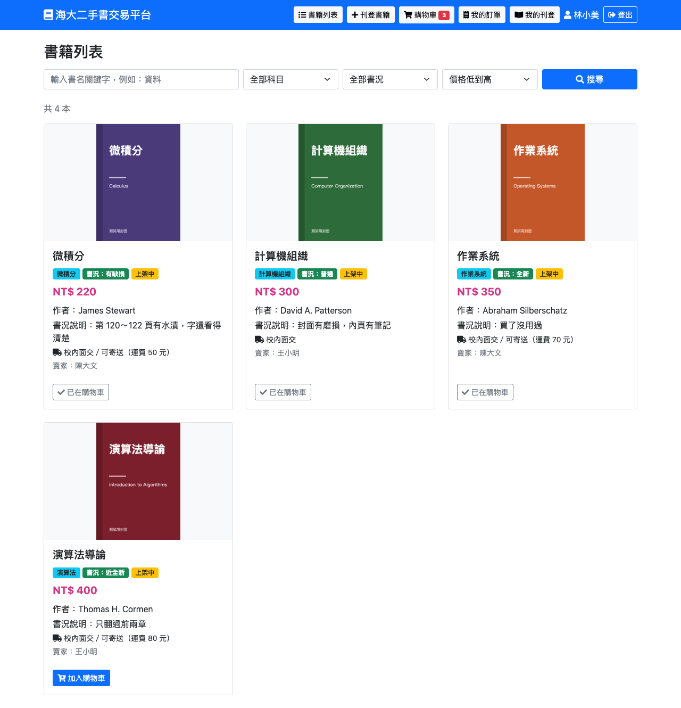

畫面 3　書籍列表

- 上方可以用書名關鍵字、科目、書況搜尋，並選排序（價格低到高、最新刊登、書況由新到舊）。不用登入也能看。
- 只顯示「上架中」的書。每張卡片有封面、科目和書況標籤、售價、書況說明、交付方式、賣家。
- 按「加入購物車」後，按鈕變成「已在購物車」。自己刊登的書不顯示購買按鈕，改顯示「這是你刊登的書」。

### 4.3 刊登書籍（US02）

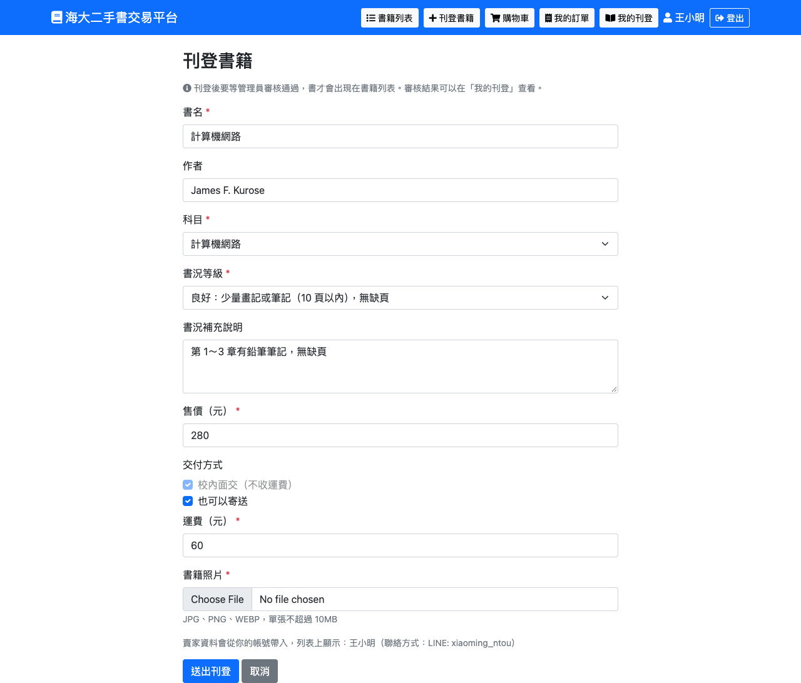

畫面 4　刊登書籍

- 有紅色星號的欄位必填。書況等級是下拉選單，每個等級附說明，賣家不用自己判斷。
- 勾選「也可以寄送」才會出現運費欄位。
- 賣家姓名和聯絡方式從帳號帶入，不用再填。
- 送出後帶到「我的刊登」，書的狀態是「待審核」。

### 4.4 購物車、送出訂單（US04）

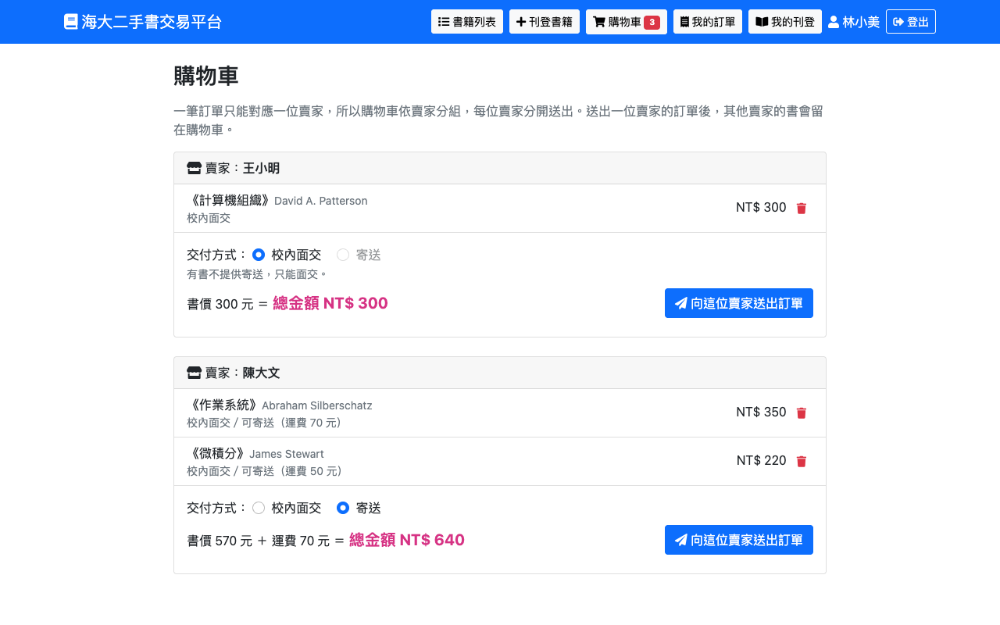

畫面 5　購物車

- 購物車依賣家分組。每組各自選交付方式、各自送出，一組送出成為一筆訂單。
- 組裡有書不能寄送時，「寄送」選項會停用，並寫出原因（畫面中王小明那一組）。選寄送時，畫面會顯示運費和總金額：陳大文那一組兩本書的運費是 70 元和 50 元，只收最高的 70 元。
- 送出一組後，其他賣家的書還留在購物車。送出失敗時顯示原因，書也都還在。

### 4.5 我的訂單（US05、US11）

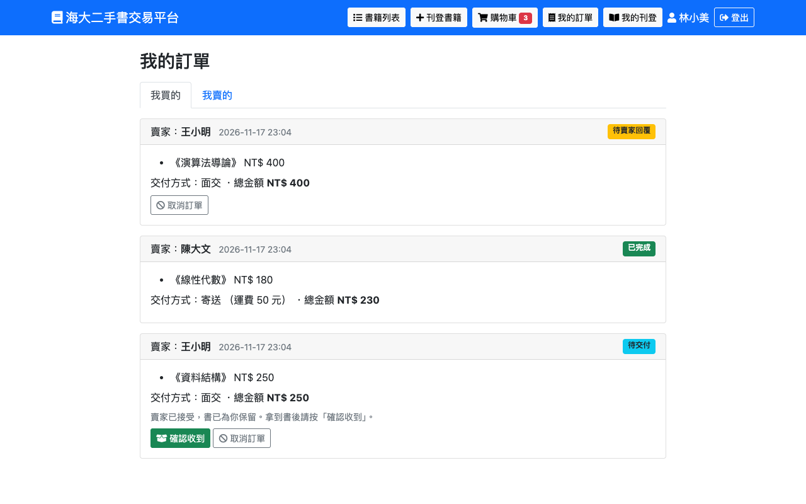

畫面 6　我的訂單：買家看自己買的

- 「我買的」和「我賣的」兩個分頁。每筆訂單顯示對方姓名、送出時間、書、交付方式、總金額和狀態標籤。
- 買家只有在「待交付」時才看得到「確認收到」按鈕。交付前可以取消訂單。

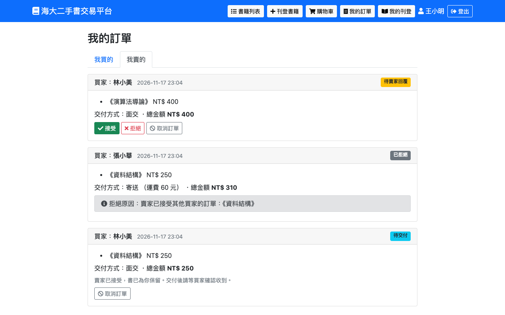

畫面 7　我的訂單：賣家看收到的訂單

- 「待賣家回覆」的訂單有「接受」、「拒絕」按鈕。
- 賣家接受某筆訂單後，同一本書其他還沒回覆的訂單會自動拒絕，並顯示拒絕原因（畫面中張小華的訂單）。

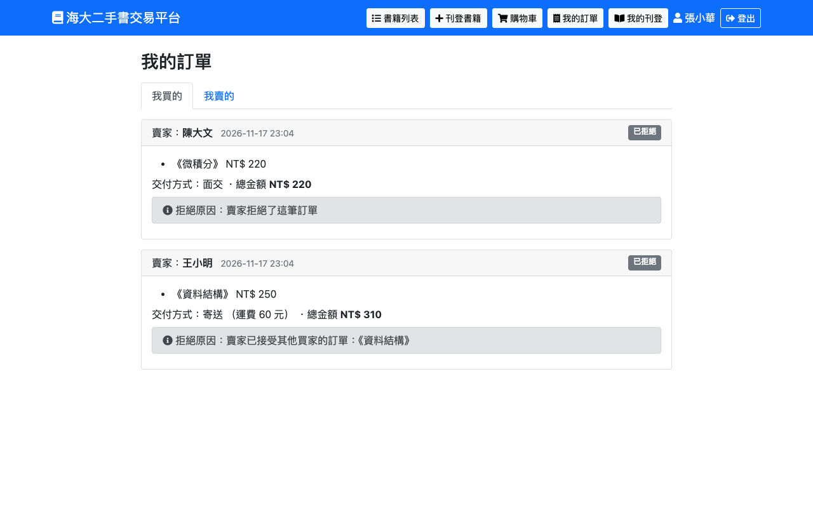

畫面 8　我的訂單：買家看到訂單被拒絕的原因

- 賣家手動拒絕時，顯示「賣家拒絕了這筆訂單」；自動拒絕時，顯示「賣家已接受其他買家的訂單：《書名》」。買家看得出是哪一種。

### 4.6 我的刊登（US02、US07）

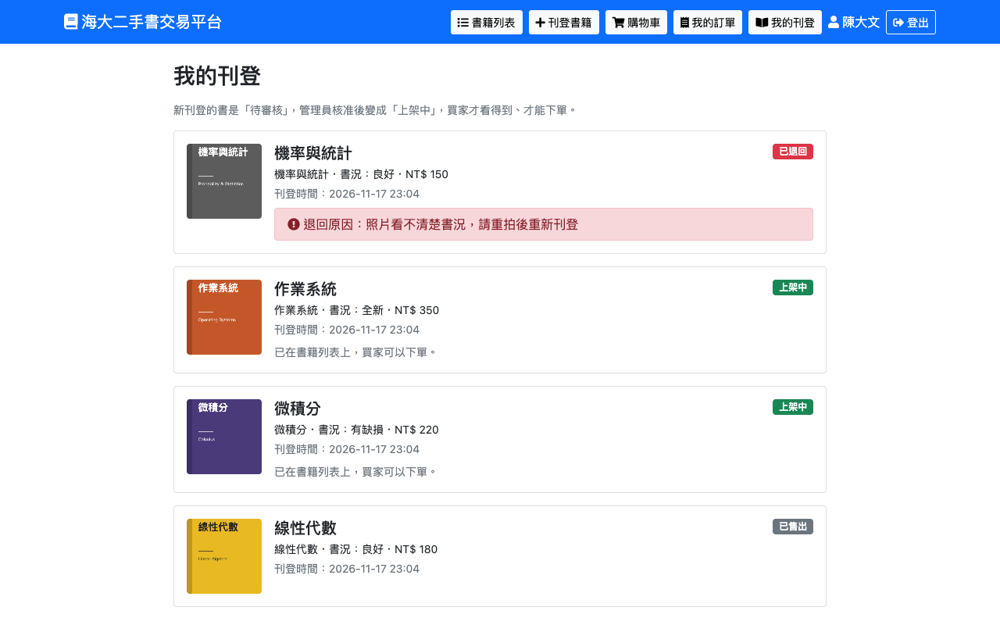

畫面 9　我的刊登

- 列出自己刊登的所有書，包含待審核、已退回、已售出的書，最新的在前。
- 被退回的書用紅底顯示退回原因。

### 4.7 審核書籍（US07，管理員）

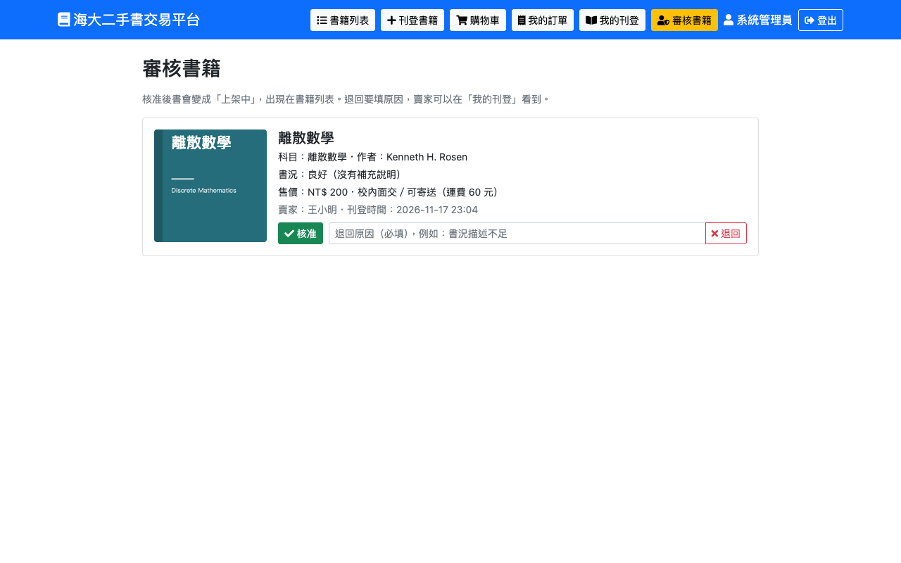

畫面 10　審核書籍

- 只有管理員看得到導覽列的「審核書籍」。其他人打開這一頁，只會看到「只有管理員可以審核」的提示。
- 列出所有「待審核」的書，先刊登的在前。管理員可以按「核准」，或填寫原因後按「退回」。原因留白時會要求補填。

---

## 5. 資料設計 (Data Design)

資料存在 MongoDB 的 `secondhandbook` 資料庫，共三個 collection：`users`（帳號）、`books`（書籍）、`orders`（訂單）。照片不存進資料庫，存成檔案，資料庫只存照片網址。

共同規則：

- `_id` 是 MongoDB 自動產生的 ObjectId。其他欄位用編號互相參照時存成字串（例如 `sellerId: "6afc6a09e072240dabc9673e"`），不用 MongoDB 的 DBRef。
- 時間欄位存成 MongoDB 的日期型別，資料庫裡是 UTC 時間（比台灣時間少 8 小時）。
- 值是 null 的欄位不會寫進文件。例如還沒審核的書沒有 `reviewedAt`，手動拒絕的訂單沒有 `rejectReason`。
- 每份文件都有 `_class` 欄位，記錄對應的 Java 類別。這是 Spring Data MongoDB 自動加的，程式不會用到。
- 狀態欄位直接存中文（例如「上架中」），和需求文件第 6 章的狀態名稱一樣。

### 5.1 users（帳號）

| 欄位 | 型別 | 必填 | 說明 |
| ---- | ---- | ---- | ---- |
| `_id` | ObjectId | 是 | 使用者編號 |
| `name` | 字串 | 是 | 姓名，刊登書籍時當作賣家名稱 |
| `email` | 字串 | 是 | 學校 Email，存小寫，只收 `@mail.ntou.edu.tw`。有唯一索引，不能重複 |
| `passwordHash` | 字串 | 是 | 密碼經 BCrypt 雜湊後的結果，資料庫裡沒有明碼 |
| `contact` | 字串 | 是 | 聯絡方式，刊登書籍時當作賣家聯絡方式 |
| `role` | 字串 | 否 | 管理員是 `"ADMIN"`；一般使用者沒有這個欄位。註冊時不能指定 |
| `createdAt` | 日期 | 是 | 註冊時間 |

索引：除了 `_id`，`email` 有唯一索引（程式啟動時由 `@Indexed(unique = true)` 自動建立）。

```json
{
  "_id": ObjectId("6afc6a09e072240dabc9673e"),
  "name": "王小明",
  "email": "seller1@mail.ntou.edu.tw",
  "passwordHash": "$2a$10$S1nFbSUa0fkTtUAs7eTXAO…（BCrypt 雜湊，共 60 個字元）",
  "contact": "LINE: xiaoming_ntou",
  "createdAt": ISODate("2026-11-17T14:51:53.760Z"),
  "_class": "ntou.cs.secondhandbook.model.User"
}
```

### 5.2 books（書籍）

| 欄位 | 型別 | 必填 | 說明 |
| ---- | ---- | ---- | ---- |
| `_id` | ObjectId | 是 | 書籍編號 |
| `title` | 字串 | 是 | 書名 |
| `author` | 字串 | 否 | 作者 |
| `subject` | 字串 | 是 | 科目，從固定清單選（資料結構、演算法、微積分……） |
| `conditionGrade` | 字串 | 是 | 書況等級：全新、近全新、良好、普通、有缺損 |
| `condition` | 字串 | 否 | 書況補充說明 |
| `price` | 整數 | 是 | 售價，正整數（元） |
| `shippable` | 布林 | 是 | 是否可寄送。校內面交一律可以，不另外存 |
| `shippingFee` | 整數 | 否 | 運費，0 以上；不可寄送時沒有這個欄位 |
| `imageUrl` | 字串 | 是 | 照片網址，格式是 `/uploads/檔名`（見 5.4） |
| `sellerId` | 字串 | 是 | 賣家的使用者編號，用來判斷誰是賣家 |
| `sellerName` | 字串 | 是 | 賣家姓名，刊登時從帳號複製，只拿來顯示 |
| `sellerContact` | 字串 | 是 | 賣家聯絡方式，刊登時從帳號複製 |
| `status` | 字串 | 是 | 待審核、上架中、保留中、已售出、已退回（見 3.2） |
| `rejectReason` | 字串 | 否 | 管理員退回的原因，只有「已退回」的書有 |
| `reviewedAt` | 日期 | 否 | 管理員核准或退回的時間 |
| `createdAt` | 日期 | 是 | 刊登時間 |

賣家姓名和聯絡方式在刊登時複製一份到書上，列表頁不用再查 `users`。代價是賣家之後改聯絡方式，舊的書不會跟著改（目前沒有修改帳號的功能）。

```json
{
  "_id": ObjectId("6afc6a0ae072240dabc96742"),
  "title": "資料結構",
  "author": "Ellis Horowitz",
  "subject": "資料結構",
  "conditionGrade": "良好",
  "condition": "第 3 章有螢光筆畫記，無缺頁",
  "price": 250,
  "shippable": true,
  "shippingFee": 60,
  "imageUrl": "/uploads/88406207-9924-4047-bca9-225a1a3c6fc1_ds.png",
  "sellerId": "6afc6a09e072240dabc9673e",
  "sellerName": "王小明",
  "sellerContact": "LINE: xiaoming_ntou",
  "status": "保留中",
  "reviewedAt": ISODate("2026-11-17T14:51:54.613Z"),
  "createdAt": ISODate("2026-11-17T14:51:54.446Z"),
  "_class": "ntou.cs.secondhandbook.model.Book"
}
```

被退回的書會多 `rejectReason`：

```json
{
  "_id": ObjectId("6afc6a0ae072240dabc96749"),
  "title": "機率與統計",
  "status": "已退回",
  "rejectReason": "照片看不清楚書況，請重拍後重新刊登",
  "reviewedAt": ISODate("2026-11-17T14:51:54.663Z"),
  "...": "其他欄位同上"
}
```

### 5.3 orders（訂單）

| 欄位 | 型別 | 必填 | 說明 |
| ---- | ---- | ---- | ---- |
| `_id` | ObjectId | 是 | 訂單編號 |
| `buyerId` | 字串 | 是 | 買家的使用者編號，用來判斷權限 |
| `buyerName` | 字串 | 是 | 買家姓名，只拿來顯示 |
| `sellerId` | 字串 | 是 | 賣家的使用者編號。一筆訂單只有一位賣家 |
| `sellerName` | 字串 | 是 | 賣家姓名，只拿來顯示 |
| `items` | 陣列 | 是 | 訂單裡的書，每本一筆（見下表），內嵌在訂單裡 |
| `deliveryMethod` | 字串 | 是 | 面交或寄送 |
| `shippingFee` | 整數 | 是 | 面交是 0；寄送時一筆訂單只收一次，取這幾本書中最高的運費 |
| `totalAmount` | 整數 | 是 | 書價合計加上 `shippingFee` |
| `status` | 字串 | 是 | 待賣家回覆、待交付、已完成、已拒絕、已取消（見 3.1） |
| `rejectReason` | 字串 | 否 | 自動拒絕的原因，例如「賣家已接受其他買家的訂單：《資料結構》」。賣家手動拒絕時沒有這個欄位 |
| `createdAt` | 日期 | 是 | 送出時間 |
| `updatedAt` | 日期 | 是 | 最後一次改狀態的時間 |

`items` 裡每一筆：

| 欄位 | 型別 | 必填 | 說明 |
| ---- | ---- | ---- | ---- |
| `bookId` | 字串 | 是 | 書籍編號 |
| `title` | 字串 | 是 | 下單時的書名 |
| `price` | 整數 | 是 | 下單時的售價 |
| `shippingFee` | 整數 | 否 | 這本書的運費；不可寄送的書沒有這個欄位 |
| `bookStatusBefore` | 字串 | 否 | 賣家接受前書的狀態，取消「待交付」訂單時把書還原成這個狀態。只有被接受過的訂單有 |

訂單把書名和售價複製一份存進 `items`，所以賣家之後改價，已送出的訂單金額不會變。書被刪掉時，訂單也還看得到買了什麼。

```json
{
  "_id": ObjectId("6afc6a0ae072240dabc9674c"),
  "buyerId": "6afc6a09e072240dabc96740",
  "buyerName": "林小美",
  "sellerId": "6afc6a09e072240dabc9673f",
  "sellerName": "陳大文",
  "items": [
    {
      "bookId": "6afc6a0ae072240dabc96746",
      "title": "線性代數",
      "price": 180,
      "shippingFee": 50,
      "bookStatusBefore": "上架中"
    }
  ],
  "deliveryMethod": "寄送",
  "shippingFee": 50,
  "totalAmount": 230,
  "status": "已完成",
  "createdAt": ISODate("2026-11-17T14:51:54.743Z"),
  "updatedAt": ISODate("2026-11-17T14:51:54.769Z"),
  "_class": "ntou.cs.secondhandbook.model.Order"
}
```

被自動拒絕的訂單（同一本書的另一筆訂單先被賣家接受）：

```json
{
  "_id": ObjectId("6afc6a0ae072240dabc9674b"),
  "buyerName": "張小華",
  "sellerName": "王小明",
  "items": [
    { "bookId": "6afc6a0ae072240dabc96742", "title": "資料結構", "price": 250, "shippingFee": 60 }
  ],
  "deliveryMethod": "寄送",
  "shippingFee": 60,
  "totalAmount": 310,
  "status": "已拒絕",
  "rejectReason": "賣家已接受其他買家的訂單：《資料結構》",
  "...": "其他欄位同上"
}
```

### 5.4 照片資料夾

```text
SecondHandBook/                  ← 程式執行的資料夾
└── upload/                      ← 照片存放位置，由設定 upload.path=upload 決定
    ├── 88406207-9924-4047-bca9-225a1a3c6fc1_ds.png
    ├── 18d82e63-ad31-437e-86bd-c90d29ff969f_algo.png
    └── ...
```

- 刊登時，`FileStorageService` 把照片存成「隨機 UUID + 底線 + 原檔名」，避免不同賣家上傳同名檔案時互相覆蓋。
- 資料夾叫 `upload/`，但網址是 `/uploads/檔名`（多一個 s）。`WebConfig` 把 `/uploads/**` 對應到 `upload/` 資料夾，書的 `imageUrl` 存的是網址。
- 看照片不用登入。單張照片上限 10 MB（`spring.servlet.multipart.max-file-size`）。
- `upload/` 不進 git，所以組員在自己電腦上看不到別人上傳的照片。

---

## 6. 類別圖設計 (Class Diagram)

類別圖分成兩張：圖 6 是前端、controller、config、exception；圖 7 是 service、repository、model。圖 6 下方的灰色虛線框是圖 7 的類別，只畫出名稱，表示 controller 會用到它們。圖中只列出主要欄位和公開方法，省略 getter／setter。後端的套件分層和第 1.2 節的元件圖一致。

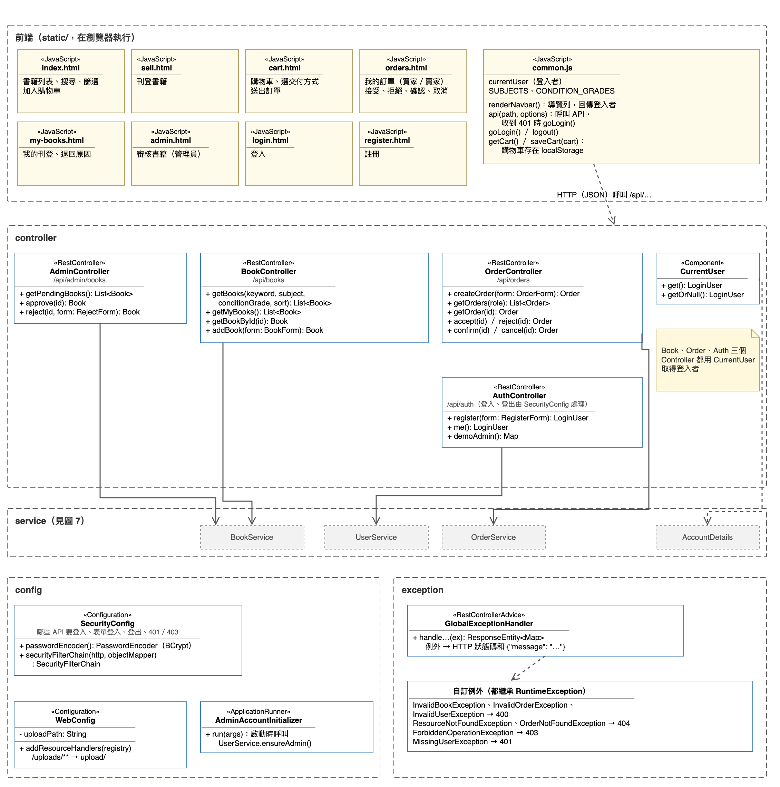

圖 6　類別圖：前端、controller、config、exception

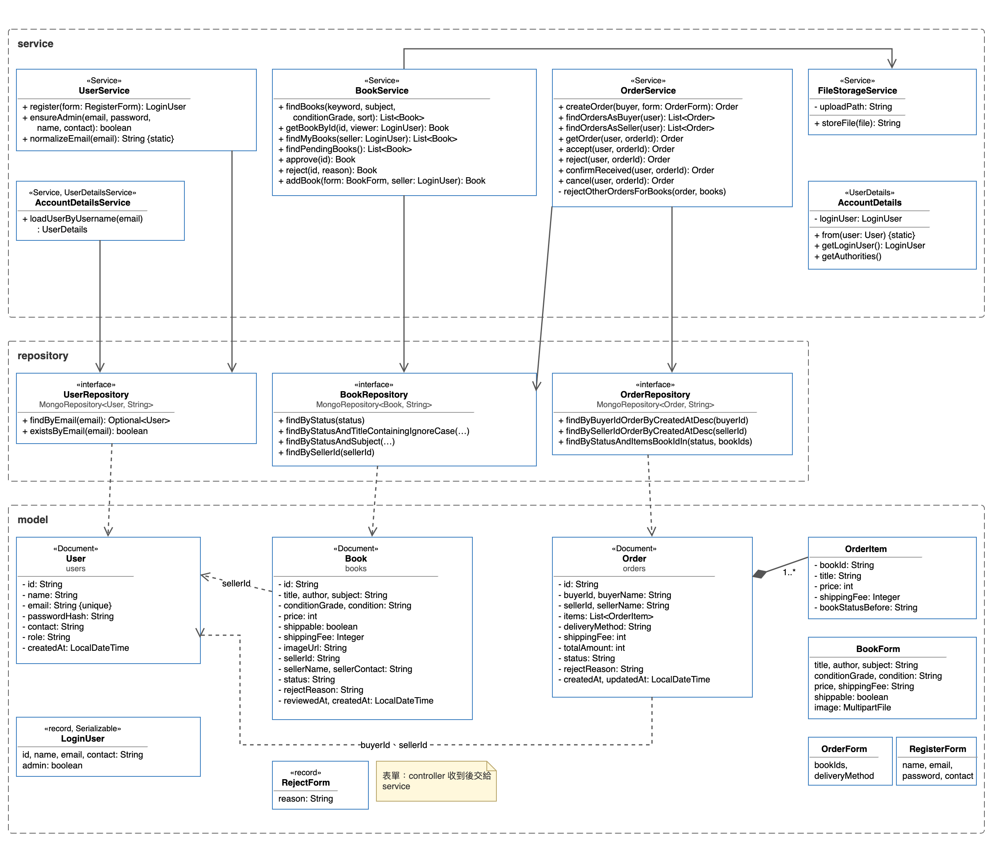

圖 7　類別圖：service、repository、model

**前端**（`static/`，標 `«JavaScript»`）：每個頁面是一個 HTML 檔，裡面的 JavaScript 透過 `common.js` 的 `api()` 呼叫後端 API。`common.js` 是各頁共用的程式：`renderNavbar()` 顯示導覽列並取得登入者；`api()` 呼叫 API，收到 401 時帶使用者去登入頁；購物車存在瀏覽器的 localStorage。各頁呼叫哪些 API 見第 2 章。

**controller**：接收 HTTP 請求，把表單（`BookForm`、`OrderForm`、`RegisterForm`、`RejectForm`）交給 service，再把結果轉成 JSON。`CurrentUser` 從 Spring Security 取得目前登入者（`LoginUser`），controller 再把登入者傳給 service。登入和登出不在 `AuthController`，由 `SecurityConfig` 設定的 Spring Security 處理。

**service**：商業邏輯都在這一層。

- `BookService`：刊登時檢查欄位、呼叫 `FileStorageService` 存照片；列表只查「上架中」的書；管理員核准和退回也在這裡（`AdminController` 直接用 `BookService`，沒有另外的審核 service）。
- `OrderService`：建立訂單、接受、拒絕、確認收到、取消。訂單狀態改變時直接用 `BookRepository` 改書的狀態；接受訂單時用 `rejectOtherOrdersForBooks` 自動拒絕同一本書的其他訂單。
- `UserService`：註冊（檢查學校 Email、密碼長度，BCrypt 雜湊）；`ensureAdmin` 在程式啟動時建立管理員帳號。
- `AccountDetailsService`、`AccountDetails`：給 Spring Security 用。登入時用 Email 查帳號，登入後把 `LoginUser` 存在 Session。管理員會得到 `ROLE_ADMIN` 權限。

**repository**：都是繼承 `MongoRepository` 的介面，Spring Data 依方法名稱自動產生查詢，不用自己寫。

**model**：`Book`、`Order`、`User` 對應第 5 章的三個 collection（標 `«Document»`）。`OrderItem` 內嵌在 `Order` 裡（組合關係，一筆訂單有 1 本以上的書）。`Book`、`Order` 用字串存使用者編號（`sellerId`、`buyerId`），圖上用虛線表示，不是物件參照。`LoginUser` 是登入者的精簡資料（沒有密碼），存在 Session 裡，所以實作 `Serializable`。

**config**：`SecurityConfig` 設定哪些 API 要登入、`/api/admin/**` 只限管理員、沒登入回 401、權限不足回 403。`WebConfig` 讓 `/uploads/**` 網址對應到照片資料夾。`AdminAccountInitializer` 在啟動時建立管理員帳號。

**exception**：service 遇到錯誤時丟出自訂例外，`GlobalExceptionHandler` 統一轉成 HTTP 狀態碼和 `{"message": "..."}`。

---

## 7. 實作方案 (Implementation Languages and Platforms)

- **平台**：網站，使用電腦瀏覽器操作。
- **前端技術與框架**：HTML、CSS、JavaScript，使用 Bootstrap 5 排版，不使用前端框架。頁面用 `fetch` 呼叫後端 REST API；共用的導覽列、API 呼叫和購物車寫在 `js/common.js`。
- **後端技術與框架**：Java 17、Spring Boot 3.3（Spring Web 提供 REST API 與靜態頁面）。程式分成 Controller、Service、Repository 三層，沿用課程 BookReview 範例的結構。
- **主要函式庫與服務**：
  - Spring Data MongoDB：存取資料庫。
  - Spring Security：表單登入、Session、權限檢查，密碼用 BCrypt 雜湊。
  - JUnit 5、Mockito、Spring Security Test：自動測試，用 `./mvnw test` 執行。
  - 資料庫：MongoDB。
  - 照片：存在伺服器本機的 `upload/` 資料夾，不使用雲端儲存。
  - 不串接金流、Email 或其他外部服務。
- **部署方式**：只在本機部署，不放到雲端或外部伺服器。在開發者的電腦執行 `./mvnw spring-boot:run`，用瀏覽器開 http://localhost:8080 ；MongoDB 也裝在同一台電腦。一個 Spring Boot 程式同時提供頁面和 API，照片資料夾也在同一台電腦。
- **原始碼**：https://github.com/leahcimm/SecondHandBook

---

## 8. 設計議題 (Design Issue)

### 議題 1：登入驗證方式（Session 還是 JWT）

- **議題內容（Issue）**：使用者登入後，系統要用什麼方式在每一次請求中辨識「目前是誰、是什麼角色」？
- **背景（Context）**：Iteration 1 沒有登入，刊登時賣家名稱是手動填寫。Iteration 2 的下單（US04）、處理訂單（US05）、確認收書（US11）、審核書籍（US07）都要知道操作者是誰、有沒有權限。組員都是第一次寫 Spring Boot，方案要容易實作與除錯。前端頁面與 API 由同一個 Spring Boot 程式提供（同源）。密碼要用 BCrypt 雜湊後儲存（NFR-03）。
- **考量方案（Alternatives）**：

| 比較標準 | 方案 A：Session + Cookie | 方案 B：JWT Token |
| -------- | ------------------------ | ----------------- |
| 做法 | 用 Spring Security 內建的表單登入，伺服器保存 Session，瀏覽器用 Cookie 帶著 Session ID。 | 登入後伺服器簽發 token，前端存起來，每次請求放在 Authorization 標頭，伺服器驗證簽章。 |
| 實作難度 | 低。大多是設定，瀏覽器自動帶 Cookie，前端呼叫 API 的程式幾乎不用改。 | 較高。要自己產生與驗證 token、處理過期，前端每個請求都要加標頭。 |
| 與目前架構的配合 | 適合。前端與 API 同源，Cookie 可以直接使用。 | 可行，但同源架構用不到它跨網域、跨裝置的優點。 |
| 停權能否立即生效 | 可以。刪除該帳號的 Session 就失效。 | 不行。token 在過期前都有效，要另外做黑名單。 |

- **決策與理由（Decision and Rationale）**：採用方案 A（Session + Cookie），已在 Iteration 2 實作完成。方案 A 實作難度低、符合同源架構，之後做停用帳號（US08）時也能立即生效。方案 B 的優點是支援手機 App 或前後端分開部署，目前沒有這兩項需求。
- **後果（Consequences）**：
  - Spring Security 預設會檢查 CSRF token。我們關掉這項檢查，改把 Session Cookie 設成 `SameSite=Lax`，讓別的網站送來的 POST 請求不帶登入 Cookie。前端因此不用多帶 token。
  - II-01 刊登書籍改成要登入，賣家姓名與聯絡方式從帳號帶入，不再手動填寫。書和訂單改用使用者編號判斷誰是賣家、誰是買家。
  - Session 存在伺服器記憶體，伺服器重新啟動後使用者要重新登入，課程專題可以接受。
  - 已用自動測試確認：沒登入呼叫 `POST /api/books` 回 401、不是管理員呼叫 `/api/admin/**` 回 403。
  - 重新檢討條件：如果之後要做手機 App，或把前端與 API 分開部署，再評估改用 JWT。

### 議題 2：賣家接受訂單後，同一本書的其他訂單怎麼處理

- **議題內容（Issue）**：同一本書可能同時有好幾筆「待賣家回覆」的訂單。賣家接受其中一筆後，其他訂單要怎麼處理？
- **背景（Context）**：送出訂單時書的狀態不變，只有賣家接受後書才變「保留中」，所以同一本書可以被好幾位買家下單。被接受的訂單之後也可能被取消，書會回到「上架中」。
- **考量方案（Alternatives）**：
  - 方案 A：其他訂單維持「待賣家回覆」，由賣家自己一筆一筆拒絕。系統只擋下第二次接受。
  - 方案 B：接受時，系統自動把同一本書其他「待賣家回覆」的訂單改成「已拒絕」，並寫上拒絕原因。
- **決策與理由（Decision and Rationale）**：採用方案 B。方案 A 要靠賣家記得去拒絕，沒拒絕的話買家會一直等，不知道書已經沒了。方案 B 讓買家立刻知道買不到，可以改買別位賣家的書。一筆訂單如果含有多本書，只要其中一本被保留，整筆都拒絕，不把訂單拆開，規則比較簡單。
- **後果（Consequences）**：
  - 訂單多了 `rejectReason` 欄位：自動拒絕寫「賣家已接受其他買家的訂單：《書名》」，賣家手動拒絕時是空的，買家看得出差別。
  - 接受的訂單之後被取消時，被自動拒絕的訂單不恢復，買家要自己再下單。這樣規則簡單，也避免好幾筆訂單同時變回待回覆。
  - 兩筆訂單在同一瞬間被接受的競爭情況沒有特別處理，課程專題先不處理。
