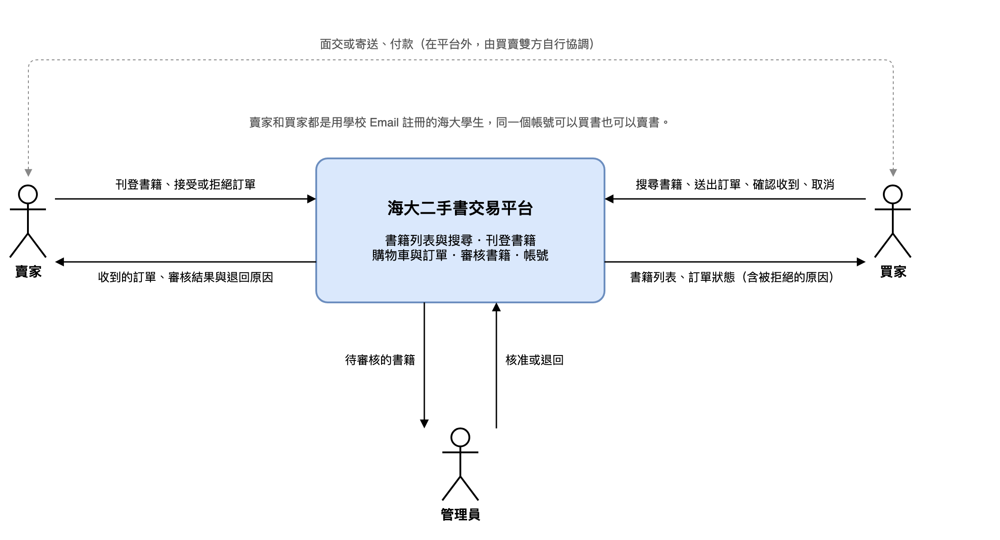
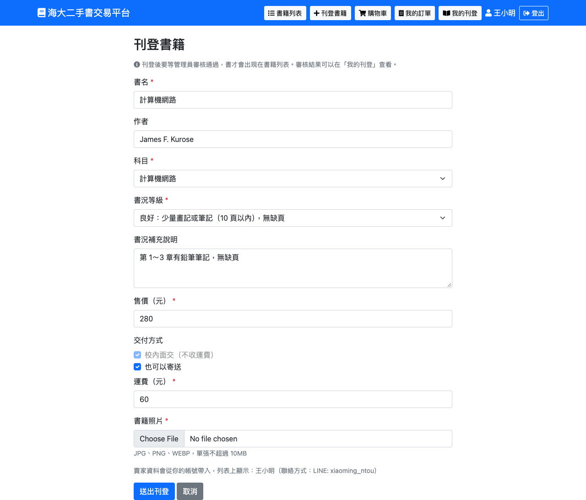
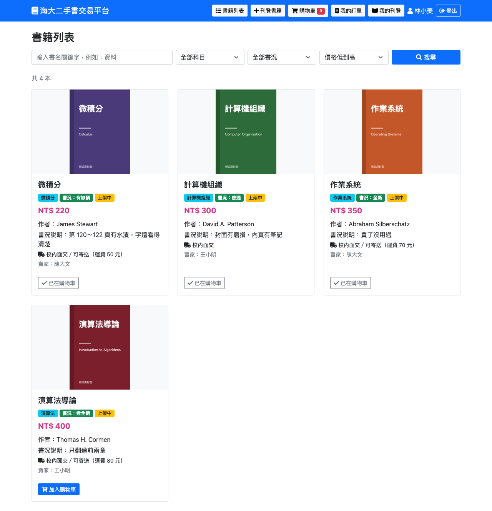
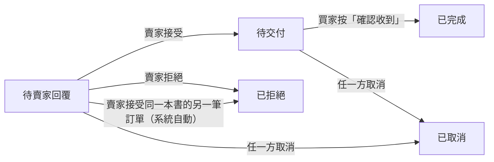

# 海大二手書交易平台 需求文件

---

## 專案資訊
- **專案名稱**：海大二手書交易平台  
- **撰寫日期**：2026/10/13（0.2 版修訂：2026/10/19；0.3 版修訂：2026/11/18）  
- **發展者**：黃宇廷（01157009）、吳紀潓（01257129）、李宥勳（01357006）、楊孟芸（01357136）、廖子宏（01357138）  

---

## 版次變更記錄

| 版次 | 變更項目 | 變更日期 |
|------|----------|----------|
| 0.1  | 初版：系統概述、操作概念、使用者故事地圖、Iteration 1 功能需求 | 2026/10/13 |
| 0.2  | 依 Iteration 1 Review 建議修訂交易確認、運費、書況、同書多賣家 | 2026/10/19 |
| 0.3  | Iteration 2：補情境圖、多位買家同時下單的處理、單筆訂單運費規則、註冊與審核的已採用做法、NFR-06、NFR-07 | 2026/11/18 |
| 0.4  |          |          |
| 0.5  |          |          |
| 0.6  |          |          |
| 1.0  |          |          |

---

## 目錄
1. [接受準則 (Acceptance Criteria)](#section1)  
2. [系統概述 (System Description)](#section2)  
3. [操作概念 (Operational Concepts)](#section3)  
4. [使用者故事地圖 (User Story Map)](#section4)  
5. [使用者介面分析 (User Interface Analysis)](#section5)  
6. [功能需求 (Functional Requirements)](#section6)  
7. [非功能需求 (Non-functional Requirements)](#section7)  

---

## 接受準則 (Acceptance Criteria of this document)
- Clearly and properly stated（需求需清楚且適當的陳述）  
- Complete（需求需完整）  
- Consistent with each other（需求之間需維持一致性）  
- Uniquely identified（每項需求有明確之識別）  
- Appropriate to implement（需求需可被實作）  
- Verifiable（需求需可被驗證）  

---

## 系統概述 (System Description)

每學期開學，海大學生都需要購買課本，而課程結束後，許多課本就被閒置。學長姐想把用過的書轉賣，學弟妹想用較低的價格買到課本，但目前多半透過社群社團貼文交易，資訊分散、難以依科目搜尋，也難以掌握訂單狀態。

本系統的目標是提供一個專屬海大學生的二手書交易平台：賣家可以刊登書籍（書名、作者、科目、書況等級與描述、售價、交付方式與照片），買家可以依搜尋、科目或書況找到需要的書，並依價格比較不同賣家的同一本書，加入購物車並送出訂單；賣家接受訂單後，雙方透過平台內的訊息約定交付，買家收到書後按下「確認收到」，交易才算完成。系統管理員負責審核刊登的書籍，並處理違規帳號。

系統主要頁面：

- 書籍列表頁：瀏覽、搜尋、依科目與書況篩選已上架書籍，預設依價格由低到高排序
- 刊登書籍頁：賣家填寫書籍資料、選擇書況等級與交付方式並上傳照片
- 書籍詳細頁：查看書況、價格、交付方式與賣家資訊，並列出其他賣家的同名書籍
- 購物車與訂單頁：買家下單並選擇交付方式、賣家接受或拒絕訂單、買家確認收到
- 訊息頁：買賣雙方協調交付時間與地點
- 管理後台：管理員審核書籍、停用違規帳號

### 情境圖

圖 1 是平台和使用者的關係，只畫使用者角色，不畫技術元件。賣家和買家都是用學校 Email 註冊的海大學生，同一個帳號可以買書也可以賣書；管理員帳號由系統預先建立。面交、寄送和付款在平台外進行，平台只記錄訂單狀態。

本系統為 Web 應用系統。前端使用 HTML、CSS、JavaScript 與 Bootstrap 5，後端使用 Java 17 與 Spring Boot 3，資料庫使用 MongoDB，照片儲存於伺服器本機資料夾。專案以課程提供之 BookReview 範例為基礎架構，採 Controller、Service、Repository 分層設計。

### 書況分級

為了讓買家能比較不同賣家的書，刊登時必須從下列五個等級選一個，細節再用文字補充。

| 等級 | 說明 |
|---|---|
| 全新 | 未使用，無任何痕跡 |
| 近全新 | 翻閱過，無畫記、無折痕 |
| 良好 | 少量畫記或筆記（10 頁以內），無缺頁 |
| 普通 | 大量畫記或筆記，封面有磨損，無缺頁 |
| 有缺損 | 有缺頁、破損或水漬，需在描述中說明 |

### 交付方式與運費

預設為校內面交，不收運費。賣家刊登時可勾選「可寄送」並填寫運費（0 以上的整數，0 代表賣家吸收運費）；買家下單時選擇面交或寄送，選寄送時訂單總金額為書價加運費。一筆訂單有多本書且選寄送時，運費只收一次，以這幾本書中最高的運費計算（例如兩本書運費 60 元與 80 元，訂單運費為 80 元）。

### 同一本書有多位賣家

一筆刊登代表「這位賣家的這一本書」，系統不合併不同賣家的資料，而是在顯示上方便買家比較：搜尋結果預設依價格由低到高排序，書籍詳細頁列出其他賣家的同名書籍。判斷是否為同一本書，有 ISBN 時以 ISBN 為準，沒有則以書名加作者相同為準（Iteration 2 先以書名加作者判斷）。

### 同一本書被多位買家同時下單

書在「上架中」時，多位買家可以同時對同一本書送出訂單，這些訂單都是「待賣家回覆」，書的狀態不變。之後的處理如下：

- **怎麼結束**：賣家接受其中一筆後，書變成「保留中」，同一本書其他「待賣家回覆」的訂單由系統自動改成「已拒絕」。一筆訂單有多本書時，只要其中一本被保留，整筆訂單都會被拒絕，不拆開。
- **怎麼通知買家**：被自動拒絕的買家在「我的訂單」頁看到訂單狀態為「已拒絕」，並顯示原因「賣家已接受其他買家的訂單：《書名》」；賣家手動拒絕時不顯示這個原因。本系統不另外寄 Email 或推播通知。
- **怎麼確保不重複成交**：一本書只屬於一位賣家，只有這位賣家可以接受訂單。接受時系統先檢查書是否還是「上架中」，不是就拒絕這次操作；接受後書變成「保留中」，其他買家不能再下單，其他待回覆的訂單也已被拒絕。限制：同一位賣家在兩個視窗幾乎同時接受同一本書的兩筆訂單時，這一版還沒有處理，預計最終版補上。
- 被接受的訂單之後被取消時，書回到「上架中」，但被自動拒絕的訂單不會恢復，買家要重新下單。

---

## 操作概念 (Operational Concepts)

<!-- TODO（5 號 需求與測試）：依下面的大綱寫成故事，每段可附一張畫面截圖或線框圖 -->

### A. 賣家刊登書籍

阿明是資工系大三學生，上學期修完「資料結構」後，課本就一直放在書架上。他打開海大二手書交易平台，點選「刊登書籍」，填入書名、作者、科目「資料結構」，書況等級選「良好」，並在補充說明寫上「第 3 章有螢光筆畫記，無缺頁」，定價 250 元。交付方式除了預設的校內面交，他也勾選「可寄送」並填上運費 60 元，最後用手機拍了一張封面照上傳。送出後，畫面顯示刊登成功，書籍狀態為「待審核」。

### B. 買家尋找書籍

小美是大二學弟妹，下學期要修「資料結構」。她在書籍列表頁選擇科目「資料結構」，發現有三位賣家在賣同一本書，售價分別是 300、200、250 元，列表已經依價格由低到高排好。她把書況篩選設為「良好」以上，比較之後點進阿明那本的詳細頁查看照片、書況說明，以及下方「其他賣家也在賣這本書」的價格，覺得阿明的價格合理。

### C. 下單與交付（Iteration 2 之後）

小美把書加入購物車，選擇交付方式「校內面交」後送出訂單，訂單狀態為「待賣家回覆」。阿明接受訂單後，這本書變成「保留中」，其他買家無法再下單。兩人透過平台訊息約定在圖書館門口面交，當場付現。小美拿到書後在訂單頁按下「確認收到」，訂單變成「已完成」，書也自動變成「已售出」並從列表下架。

本系統不提供線上金流，付款由雙方自行協調：面交時當場付現；寄送時由雙方約定轉帳或貨到付款，總金額為書價加運費。

### D. 管理員審核（Iteration 2 之後）

系統管理員每天檢查待審核的書籍，核准內容完整的刊登；遇到描述不清或內容不當的刊登，填寫退回原因。賣家在「我的刊登」頁看到退回原因，修正後重新刊登。

---

## 使用者故事地圖 (User Story Map)

Miro 連結：【[ Miro 網址](https://miro.com/app/board/uXjVEcYsoOo=/?share_link_id=915811621196)】

| 加入平台 | 刊登書 | 找書 | 下單 | 交易溝通 | 平台管理 |
|---|---|---|---|---|---|
| US01 註冊帳號 | **US02 刊登書籍** | **US03 尋找書籍** | US04 送出訂單 | US06 協調交付 | US07 審核書籍 |
| | US10 下架書籍 | US09 了解書籍資訊 | US05 處理訂單 | US11 確認收書 | US08 處理違規帳號 |

粗體為 Iteration 1 實作範圍。US11 確認收書為 0.2 版依 Iteration 1 Review 建議新增，放在 Release 2。進階功能（評價、熱門推薦、黑名單、統計、書籍交換、超過 7 天未確認的提醒）列於 MVP 線以下，後續 Iteration 再規劃。

### MVP 故事細部分析

#### US01 註冊帳號
- **代號**：US01 註冊帳號  
- **故事**：身為要買書或賣書的使用者，我可以填寫姓名、帳號、密碼與基本聯絡方式完成註冊，讓我能以自己的身分參與平台交易。  
- **註記**：  
  - 帳號必須具備唯一性，不可重複註冊。  
  - 以學校 Email 作為唯一登入帳號，只接受 `@mail.ntou.edu.tw` 結尾的 Email（0.3 版採用）。  
  - 密碼至少 8 個字元，最多 72 個英數字元。  
- **測試方法**：  
  - 輸入未註冊過的學校 Email 並設定密碼，應註冊成功並跳轉到登入頁面。  
  - 輸入重複的帳號、非學校帳號或格式不正確的資料，應註冊失敗並顯示原因。  

#### US02 刊登書籍（Iteration 1）
- **代號**：US02 刊登書籍  
- **故事**：身為賣家，我可以填寫書名、作者、科目、書況、售價並上傳照片來刊登書籍，讓有需要的買家能了解我想出售的書。  
- **註記**：  
  - 題目指定欄位：書名、作者、科目、書況描述、售價、照片。  
  - 書況改為「書況等級（必選，五級見第 2 章書況分級）＋書況描述（選填補充）」。  
  - 書名、科目、書況等級、售價、照片為必填；售價為正整數（元）。  
  - 可選擇交付方式：校內面交（預設）／寄送；勾選寄送時必須填寫運費（0 以上的整數）。  
  - 照片格式限 JPG、PNG、WEBP，單張不超過 10MB。  
  - 刊登後狀態預設為「待審核」（審核功能於 US07 實作）。  
- **測試方法**：  
  - 填入所有欄位並上傳一張 2MB 的 JPG，送出後應顯示刊登成功，書籍狀態為「待審核」，列表頁還看不到；管理員核准後，列表頁出現這本書與照片。  
  - 書名留白送出，應提示「請填寫書名」，不建立資料。  
  - 售價輸入 -50 或 abc，應提示售價必須為正整數。  
  - 上傳超過 10MB 的照片，應提示檔案過大，不建立資料。  
  - 未選書況等級送出，應提示「請選擇書況」，不建立資料。  
  - 勾選寄送但運費留白，應提示「勾選寄送時請填寫運費」；運費輸入 -1 或 abc，應提示運費必須為 0 以上的整數，不建立資料。  

#### US03 尋找書籍（Iteration 1）
- **代號**：US03 尋找書籍  
- **故事**：身為買家，我可以透過搜尋或科目分類瀏覽書籍清單，讓我能找到符合課程需要的二手書。  
- **註記**：  
  - 列表以卡片顯示照片、書名、科目、書況等級、售價與交付方式。  
  - 搜尋以書名部分符合為準（例如輸入「資料」可找到「資料結構」）。  
  - 可依書況等級篩選。  
  - 預設依價格由低到高排序，也可以改成依書況或刊登時間排序，方便比較不同賣家的同一本書。  
  - 列表只顯示「上架中」的書；待審核、已退回、保留中、已售出的書都不顯示。  
- **測試方法**：  
  - 新增 3 本書後打開列表頁，應看到 3 張卡片，資料與刊登時一致。  
  - 沒有任何書時，列表頁應顯示「目前沒有書籍」，而不是空白。  
  - 搜尋「資料」，應只顯示書名包含「資料」的書。  
  - 三位賣家賣同一本書，價格 300／200／250，搜尋後應依 200、250、300 排序。  
  - 書況篩選選「良好」，應只顯示書況等級為「良好」的書。  

#### US04 送出訂單
- **代號**：US04 送出訂單  
- **故事**：身為買家，我可以將想買的書加入購物車，確認金額後向一位賣家送出訂單，讓我能清楚地提出購買需求。  
- **註記**：  
  - 題目規則：每筆訂單只能對應一位賣家。  
  - 提案：購物車可放不同賣家的書；每次只結算選定賣家的書，其餘保留。  
  - 提案：送出前顯示書籍、賣家與總金額；成功後為「待賣家回覆」。  
  - 買家選擇交付方式（面交或寄送，寄送限賣家有勾選可寄送的書），選寄送時總金額包含運費；一筆訂單的運費只收一次，取這幾本書中最高的運費（見第 2 章交付方式與運費）。  
  - 限制：購物車存在使用者的瀏覽器，不跟著帳號走。換一台電腦或換一個瀏覽器看不到原本的購物車；同一個瀏覽器換帳號登入，會看到上一個帳號放的書。  
  - 購物車已有同名書籍（不同賣家）時，加入前提示「購物車已有同名書籍」。  
  - 本次不增加線上金流，付款由雙方自行協調（見第 3 章 C）。  
- **測試方法**：  
  - A 的兩本書為 200 元與 150 元，送出後應只有一筆 A 的訂單，兩本書，總額 350 元。  
  - 購物車有 A、B 的書，選 A 送出後，訂單只含 A 的書，B 的書仍保留。  
  - 空購物車送出，應提示沒有書籍，不建立訂單。  
  - 送出失敗時，應提示失敗並保留所選書籍，讓買家可重試。  
  - 200 元的書選擇寄送（運費 60 元），總額應顯示 260 元；改選面交，總額應顯示 200 元。  

#### US05 處理訂單
- **代號**：US05 處理訂單  
- **故事**：身為賣家，我可以查看收到的訂單並接受或拒絕，讓我能決定要把書賣給哪位買家。  
- **註記**：  
  - 訂單狀態流程見第 6 章「訂單狀態」。  
  - 接受後訂單變為「待交付」，書籍變為「保留中」，其他買家不能再下單。  
  - 拒絕後訂單變為「已拒絕」，書籍回到「上架中」。  
  - 接受一筆訂單後，同一本書其他「待賣家回覆」的訂單自動變為「已拒絕」，買家看得到原因（見第 2 章「同一本書被多位買家同時下單」）。  
- **測試方法**：  
  - 賣家接受訂單後，訂單狀態為「待交付」，書籍變為「保留中」，從書籍列表消失，其他買家無法再下單。  
  - 賣家拒絕訂單後，訂單狀態為「已拒絕」，該書重新出現在列表且可再下單。  
  - 非該訂單的賣家嘗試接受或拒絕，應拒絕操作，訂單狀態不變。  
  - 兩位買家對同一本書各送出一筆訂單，賣家接受第一筆後，第二筆變為「已拒絕」，第二位買家在訂單頁看到「賣家已接受其他買家的訂單：《書名》」。  

#### US06 協調交易交付
- **代號**：US06 協調交易交付  
- **故事**：身為買家，我希望可以與賣家確認交付時間、地點及方式，以便順利完成二手書交易。  
- **註記**：  
  - 題目規則：平台內訊息約定交付。  
  - 提案：系統內建對話視窗，對話需綁定特定「訂單」或「書籍刊登」，方便雙方對照。  
  - 訊息內容為必填；傳送後顯示於對話視窗中，且發送後不可修改或刪除。
  - 提案：收到新訊息時，系統頂端導覽列需顯示未讀數字或紅點提示。  
  - 面交地點建議：圖書館門口、學生餐廳等校內公共場所。  
- **測試方法**：  
  - 買家在訂單頁面發送訊息「約明早 10 點圖書館面交」，賣家頁面應即時（或重新整理後）顯示該訊息且點亮未讀提示。  
  - 訊息內容未填寫（空白）即點擊送出，應禁用送出按鈕或提示「內容不可為空白」，不建立對話紀錄。
  - 當訊息發送失敗（如網路中斷）時，系統應提示送出失敗並保留已輸入文字，方便買家重新嘗試。  

#### US07 審核書籍
- **代號**：US07 審核書籍  
- **故事**：身為系統管理員，我可以查看待審核的書籍資料並核准或退回，讓我能避免不適當的刊登內容出現在平台上。  
- **註記**：  
  - 題目：管理員審核刊登書籍。  
  - 刊登先進入「待審核」，核准後才對買家公開（0.3 版採用，以下兩條同）。  
  - 退回必填原因，賣家在「我的刊登」頁查看退回原因。  
  - 只有管理員可核准或退回。  
  - 管理員帳號由系統預先建立，不開放註冊成管理員。  
- **測試方法**：  
  - 核准待審核書籍，狀態改為「上架中」，買家能在清單中找到。  
  - 輸入「書況描述不足」後退回，買家看不到，賣家看得到原因。  
  - 原因留白就退回，應要求補填，狀態維持「待審核」。  
  - 買家或賣家嘗試核准，應拒絕操作，書籍狀態不變。  

#### US09 了解書籍資訊
- **代號**：US09 了解書籍資訊  
- **故事**：身為買家，我可以點進書籍詳細頁查看照片、書況、價格、交付方式與賣家資訊，讓我在下單前確認這本書符合需求。  
- **註記**：  
  - 詳細頁顯示書況等級與該等級的說明（見第 2 章書況分級），以及賣家的書況補充描述。  
  - 詳細頁下方顯示「其他賣家也在賣這本書」，列出同名書籍的價格、書況與賣家（同一本書的判斷方式見第 2 章）。  
- **測試方法**：  
  - 點進書況等級為「良好」的書，應顯示「良好：少量畫記或筆記（10 頁以內），無缺頁」。  
  - 三位賣家賣同一本書時，點進其中一本，下方應列出另外兩位賣家的價格與書況。  
  - 只有一位賣家時，不顯示「其他賣家也在賣這本書」區塊。  

#### US10 下架書籍
- **代號**：US10 下架書籍  
- **故事**：身為賣家，我可以將尚未售出的書籍手動下架，且訂單完成後書籍會自動下架，讓列表上只留下還能購買的書。  
- **註記**：  
  - 訂單完成（買家確認收到）後，書籍自動變為「已售出」並從列表下架。  
  - 賣家可手動下架「上架中」的書籍；「保留中」的書需先取消訂單才能下架。  
- **測試方法**：  
  - 買家按下確認收到後，該書狀態為「已售出」，列表上找不到這本書。  
  - 賣家手動下架上架中的書，列表上找不到這本書，賣家自己的刊登紀錄仍看得到。  
  - 賣家嘗試下架保留中的書，應提示需先處理訂單，書籍狀態不變。  

#### US11 確認收書（0.2 新增）
- **代號**：US11 確認收書  
- **故事**：身為買家，我可以在拿到書後按下確認收到，讓交易正式完成，賣家也能知道款項與交付已結清。  
- **註記**：  
  - 「交易確認」定義為：買家收到書後按下「確認收到」，訂單變為「已完成」。  
  - 只有「待交付」的訂單可以確認收到；交付前任一方可取消訂單，書籍回到「上架中」。  
  - 進階：超過 7 天沒有確認也沒有取消，系統提醒雙方。  
- **測試方法**：  
  - 買家在「待交付」的訂單按確認收到，訂單變為「已完成」，書籍變為「已售出」。  
  - 「待賣家回覆」的訂單不顯示確認收到按鈕。  
  - 賣家嘗試替買家按確認收到，應拒絕操作，訂單狀態不變。  
  - 交付前買家取消訂單，訂單變為「已取消」，書籍回到「上架中」。  

---

## 使用者介面分析 (User Interface Analysis)

### 刊登書籍頁

賣家在此頁填寫書名、作者、科目（下拉選單）、書況等級（下拉選單，附等級說明）、書況補充說明、售價、交付方式並上傳照片。交付方式預設為校內面交；勾選「也可以寄送」後才會出現運費欄位。賣家稱呼與聯絡方式從帳號帶入，不用再填。必填欄位未填或格式錯誤時，欄位下方會顯示紅字提示；送出成功後跳到「我的刊登」頁，顯示刊登成功，書籍狀態為「待審核」，管理員核准後才會出現在書籍列表。

### 書籍列表頁

以卡片方式顯示「上架中」的書籍，每張卡片包含封面照片、書名、科目、書況等級、售價、交付方式（寄送時顯示運費）、賣家與「加入購物車」按鈕；已在購物車的書顯示「已在購物車」，自己刊登的書不能加入。頁面上方提供搜尋框、科目篩選、書況篩選與排序方式，並顯示目前符合條件的書籍數量。

- **搜尋與篩選**：輸入關鍵字或選擇科目、書況後，列表即時更新。
- **排序**：預設依價格由低到高，可改為最新刊登或書況由新到舊。
- **空狀態**：
  - 沒有任何書籍時，顯示「目前沒有書籍」。
  - 搜尋或篩選沒有結果時，顯示「找不到符合條件的書籍」。

---

## 功能需求 (Functional Requirements)

<!-- TODO（2 號 後端）：依實作結果補充與修正 -->

| 功能編號 | 功能名稱     | 功能說明                                                         | 使用者       |
| -------- | ------------ | ---------------------------------------------------------------- | ------------ |
| **帳號** |              |                                                                  |              |
| FR-AC-01 | 註冊         | 使用者可填寫姓名、帳號、密碼與聯絡方式註冊帳號，帳號不可重複。   | 未登入使用者 |
| FR-AC-02 | 登入         | 使用者可使用已註冊的帳號密碼登入系統。                           | 未登入使用者 |
| **書籍** |              |                                                                  |              |
| FR-BK-01 | 刊登書籍     | 賣家可填寫書名、作者、科目、書況等級（五級必選）與書況描述、售價、交付方式（面交／寄送，寄送須填運費）並上傳照片刊登書籍。 | 賣家         |
| FR-BK-02 | 刊登資料檢查 | 系統應檢查必填欄位、書況等級、售價與運費格式，不符合時拒絕刊登並提示原因。 | 賣家         |
| FR-BK-03 | 書籍列表     | 使用者可瀏覽所有已上架的書籍，以卡片顯示照片、書名、科目、書況等級、售價與交付方式。 | 所有使用者   |
| FR-BK-04 | 搜尋書籍     | 使用者可輸入關鍵字，搜尋書名包含該關鍵字的書籍。                 | 所有使用者   |
| FR-BK-05 | 科目篩選     | 使用者可選擇科目，只顯示該科目的書籍。                           | 所有使用者   |
| FR-BK-06 | 修改與下架 | 賣家可修改自己刊登的書籍資料，或將尚未售出的書籍手動下架；訂單完成後書籍自動下架。 | 賣家 |
| FR-BK-07 | 排序 | 書籍列表預設依價格由低到高排序，使用者可改為依書況或刊登時間排序。 | 所有使用者 |
| FR-BK-08 | 同名書籍比較 | 書籍詳細頁列出其他賣家的同名書籍（書名＋作者相同）的價格、書況與賣家。 | 所有使用者 |
| FR-BK-09 | 書況篩選 | 使用者可選擇書況等級，只顯示該等級的書籍。 | 所有使用者 |
| **訂單** | | | |
| FR-OD-01 | 購物車 | 買家可將書籍加入購物車或移除。 | 買家 |
| FR-OD-02 | 送出訂單 | 買家可選擇一位賣家的書籍並選擇交付方式（面交／寄送）送出訂單，每筆訂單只對應一位賣家；選寄送時總金額為書價加運費，運費只收一次，取最高的一筆。 | 買家 |
| FR-OD-03 | 處理訂單 | 賣家可查看收到的訂單並接受或拒絕；接受後書籍變為保留中，同一本書其他待賣家回覆的訂單自動變為已拒絕並顯示原因；拒絕後書籍回到上架中。 | 賣家 |
| FR-OD-04 | 確認收書 | 買家收到書後可按確認收到，訂單變為已完成，書籍變為已售出。 | 買家 |
| FR-OD-05 | 取消訂單 | 交付前（訂單為待賣家回覆或待交付）買家或賣家可取消訂單，書籍回到上架中。 | 買家、賣家 |
| **訊息** | | | |
| FR-MS-01 | 交易訊息 | 買賣雙方可在訂單內互傳訊息，協調交付時間與地點。 | 買家、賣家 |
| **管理** | | | |
| FR-AD-01 | 審核書籍 | 管理員可核准或退回待審核書籍，退回時須填寫原因。 | 管理員 |
| FR-AD-02 | 停用帳號 | 管理員可停用經確認違規的帳號。 | 管理員 |

### 訂單狀態

| 訂單狀態 | 誰可以做什麼 | 書籍狀態 |
|---|---|---|
| 待賣家回覆 | 賣家接受或拒絕；買家或賣家可取消；賣家接受同一本書的另一筆訂單時，系統自動改成已拒絕並顯示原因 | 上架中 |
| 待交付 | 雙方用訊息約定交付；買家收到書後按「確認收到」；交付前任一方可取消 | 保留中（其他人不能下單） |
| 已完成 | 交易結束 | 已售出（自動下架） |
| 已拒絕／已取消 | 交易結束 | 回到上架中 |

### 書籍狀態

| 書籍狀態 | 說明 |
|---|---|
| 待審核 | 剛刊登，等待管理員審核（US07），買家看不到 |
| 上架中 | 審核通過，買家可以找到並下單 |
| 保留中 | 賣家已接受某筆訂單，其他買家不能下單 |
| 已售出 | 訂單完成後自動設定，不再顯示於列表 |
| 已下架 | 賣家手動下架，不再顯示於列表 |
| 已退回 | 管理員退回，賣家可在「我的刊登」查看原因；不能修改後再送審，要重新刊登 |

---

## 非功能需求 (Non-functional Requirements)

<!-- TODO（5 號）：確認數字是否合理，並在實測後記錄結果 -->

| 需求編號 | 需求說明 |
|---|---|
| NFR-01 | 書籍數量在 500 筆以內時，書籍列表頁應在 2 秒內顯示完成。 |
| NFR-02 | 刊登一本附 5MB 照片的書籍，從按下送出到顯示成功應在 3 秒內完成。 |
| NFR-03 | 使用者密碼須經雜湊（如 BCrypt）後才儲存，資料庫中不得出現明碼。 |
| NFR-04 | 使用者輸入的文字顯示在頁面時須經過跳脫處理，輸入 `<script>` 等內容不會被執行。 |
| NFR-05 | 頁面採 RWD 設計，在寬度 375px 的手機與 1920px 的電腦螢幕上皆可正常操作。 |
| NFR-06 | 同時有 50 位使用者上線時，書籍列表頁應在 2 秒內顯示完成，送出訂單與接受訂單應在 3 秒內完成。 |
| NFR-07 | 一本書最多只能有一筆被接受的訂單。賣家接受一筆訂單後，同一本書其他待賣家回覆的訂單自動變為已拒絕，並向買家顯示原因。 |

NFR-06、NFR-07 為 0.3 版新增。表中所有 NFR 都是目標值，目前都還沒有實測紀錄；NFR-05（手機版面）尚未完成。NFR-07 中「同一位賣家幾乎同時接受同一本書的兩筆訂單」的情況這一版還沒有處理（見第 2 章「同一本書被多位買家同時下單」）。

---
